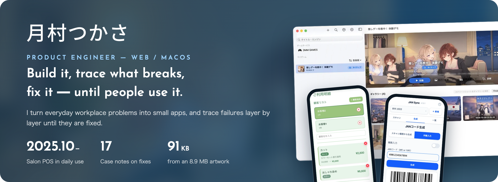
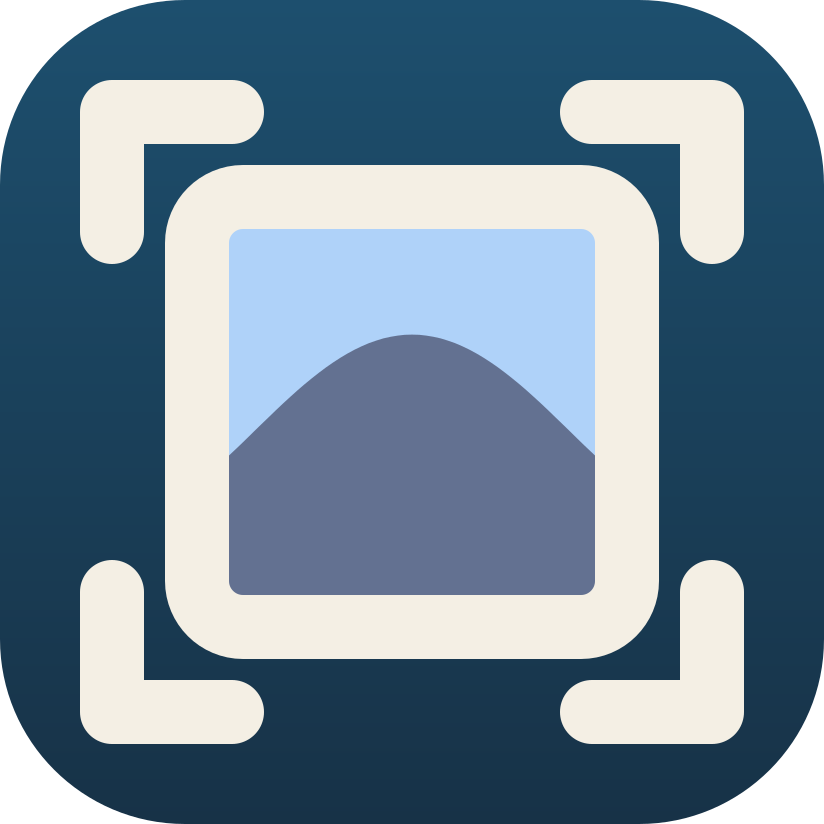
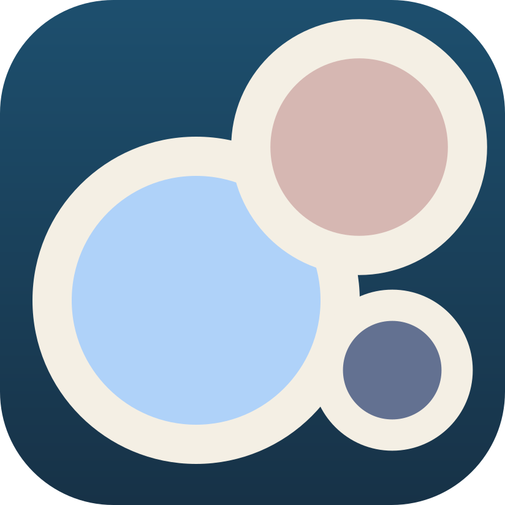

  

  <a href="https://tsukasa-art.com/"><b>Portfolio</b></a> ·
  <a href="https://zenn.dev/tsukasa_art"><b>Zenn</b></a> ·
  <a href="https://tsukasa-art.com/contact/"><b>Contact</b></a> ·
  <a href="./README.md">日本語</a>

> **Open to software engineering roles in Japan.** I can start about one month after accepting an offer. I am looking for work on business applications that solve everyday workplace problems, or on in-house products. Based in Sapporo; open to Tokyo. 
> I publish my work under the pen name Tsukasa / 月村つかさ. The linked portfolio pages are in Japanese.

 

## In daily use

<table>
<tr>
<td width="50%" valign="top">

<h3>Salon Register</h3>
<b>A point-of-sale app used every day at a hair salon since October 2025.</b> 
Discounts that change with the combination of services are applied automatically at checkout, so staff no longer calculate them by hand. Fewer mistakes, shorter waits at the counter.  
<a href="https://tsukasa-art.com/projects/salon-register/">Case study</a> · <a href="https://salon-register-demo.pages.dev/">Live demo</a> · <a href="https://github.com/tsukasa-art/salon-register-demo">GitHub</a>
</td>
<td width="50%" valign="top">

<h3>JAN Sync</h3>
<b>Scan and count stock at the shelf with nothing but a phone.</b> 
Scanning the same item again raises its count, and the list exports straight to a spreadsheet. It works offline, and scanned codes never leave the device.  
<a href="https://tsukasa-art.com/projects/jan-sync/">Case study</a> · <a href="https://jan-sync.pages.dev/">Live demo</a> · <a href="https://github.com/tsukasa-art/jan-sync">GitHub</a>
</td>
</tr>
</table>

## Orrery — Windows visual novels on the Mac

<table>
<tr>
<td width="50%" valign="top">

<h3>KASANE</h3>
<b>A launcher for playing Windows visual novels on Apple Silicon Macs.</b> 
Titles that do not run on existing Wine setups are made to work by isolating each failure — rendering, video, audio, window handling. The closed-beta waitlist is open.  
<a href="https://tsukasa-art.com/en/projects/orrery/kasane/">KASANE</a> · <a href="https://tsukasa-art.com/projects/orrery/">Orrery overview</a>
</td>
<td width="50%" valign="top">

<h3>Case Notes — 17</h3>
<b>Failures traced from the symptom down to the layer that broke.</b> 
From symptoms like "only the video is white" or "the save image is black", each note pins down where Wine, DirectX, or Metal stopped, and records how it was fixed.  
<a href="https://tsukasa-art.com/projects/orrery/notes/why-mac-windows-games-are-hard/">Start here</a> · <a href="https://github.com/tsukasa-art/swingby-wine">swingby-wine</a> · <a href="https://github.com/tsukasa-art/swingby-dxvk">swingby-dxvk</a> · <a href="https://github.com/tsukasa-art/melammu-vn">melammu-vn</a>
</td>
</tr>
</table>

## Tools for drawing

<table>
<tr>
<td width="50%" valign="top">

<h3>&nbsp;zenpix</h3>
<b>An 8.9 MB artwork, down to 91 KB.</b> 
An image conversion library written in C. Decoding, resizing, and AVIF / WebP encoding are available from the CLI, Node.js, Bun, Deno, and the browser (WASM). The images on my portfolio are converted with it.  
<a href="https://tsukasa-art.com/projects/zenpix/">Case study</a> · <a href="https://zenpix.tsukasa-art.com/">Docs</a> · <a href="https://www.npmjs.com/package/zenpix">npm</a> · <a href="https://github.com/tsukasa-art/zenpix">GitHub</a>
</td>
<td width="50%" valign="top">

<h3>&nbsp;teinte</h3>
<b>Put the colors of an artwork into numbers and names.</b> 
A desktop app that extracts the main colors of an image, finds the nearest Open Color and Tailwind names, and sorts them into base, assort, and accent roles. Built with Vue, Rust, and Tauri.  
<a href="https://tsukasa-art.com/projects/teinte/">Case study</a> · <a href="https://github.com/tsukasa-art/teinte">GitHub</a>
</td>
</tr>
</table>

## Zenn (Japanese)

What I observed, the hypotheses I tried, the dead ends, and the final call — written up so others can reproduce them.
- [Series: running Windows visual novels on the Mac](https://zenn.dev/tsukasa_art/articles/mac-eroge-compat-part1)
- [Book: from code to runtime](https://zenn.dev/tsukasa_art/books/code-to-runtime) · [Book: how media playback works](https://zenn.dev/tsukasa_art/books/media-playback-pipeline)

## How I work

- Check logs, reproduction steps, and real device behavior before guessing
- Choose technology with the user experience, operations, and reproducibility in mind
- When I use AI agents, I keep the scope of disclosure, review, verification, and the final call
- Leave a trail of why something changed, what it fixed, and how it was verified

**Languages:** TypeScript / JavaScript / C / Rust / Swift 
**Frameworks & UI:** React / React Router v7 / Next.js / Astro / Vue / SolidJS / Svelte / SvelteKit / SwiftUI / Tauri 
**Product engineering:** Ruby on Rails rebuild prototype / PWA and offline-first / CMS and rich-text editing (Tiptap) / Authentication and sessions (Oslo / Better Auth) / PostgreSQL and Cloudflare D1 / Wine / macOS / Cloudflare

## Contact

For hiring or development inquiries, please use the [contact form](https://tsukasa-art.com/contact/).
