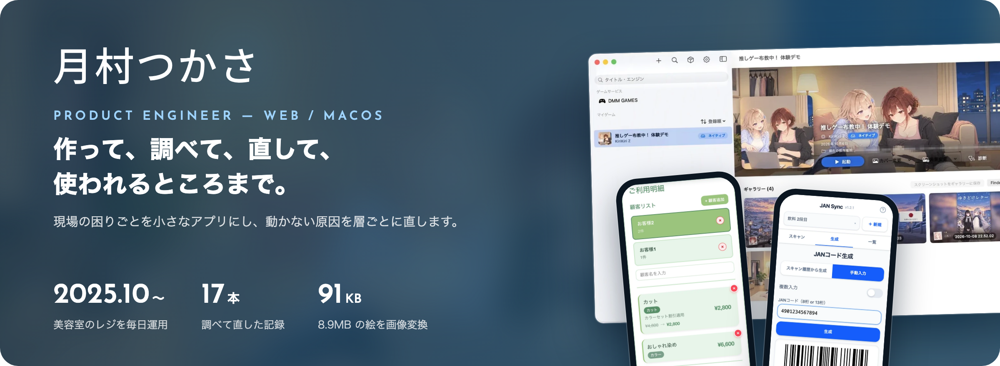
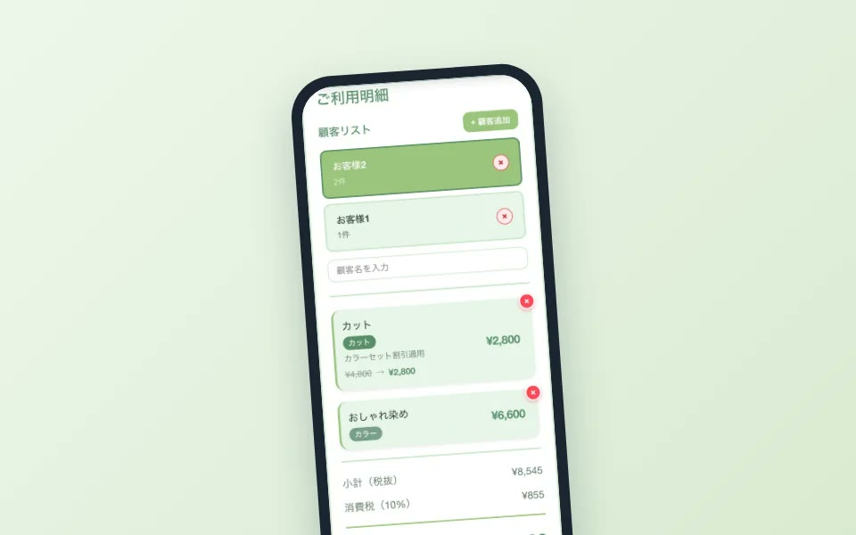
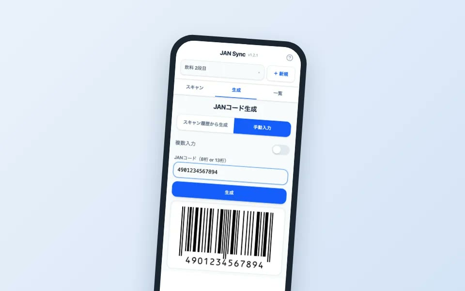
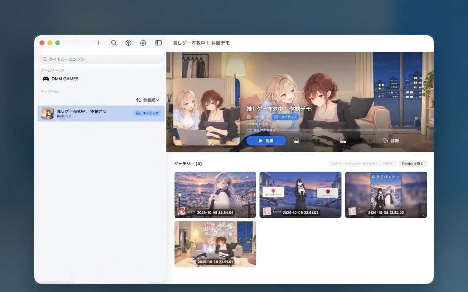
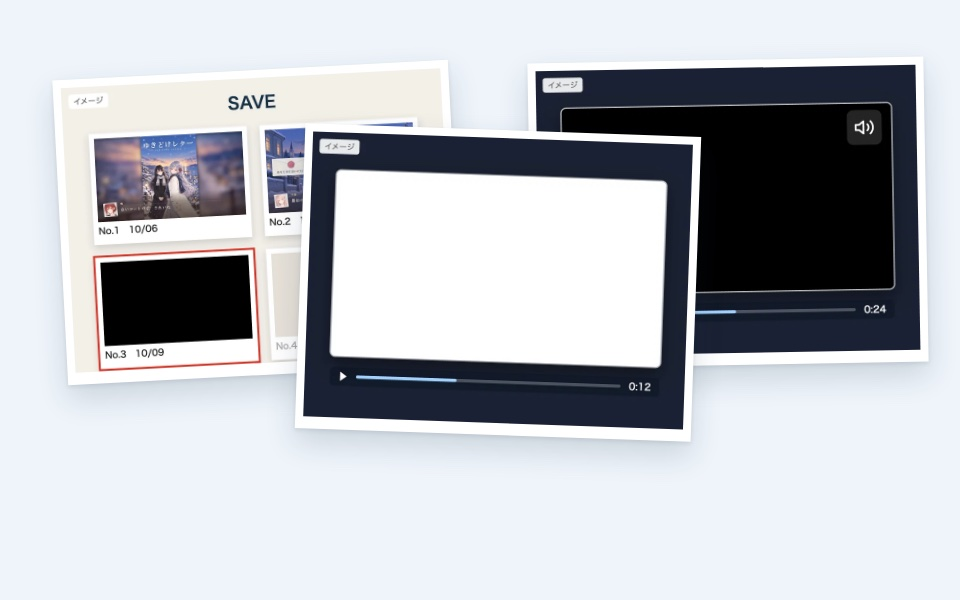
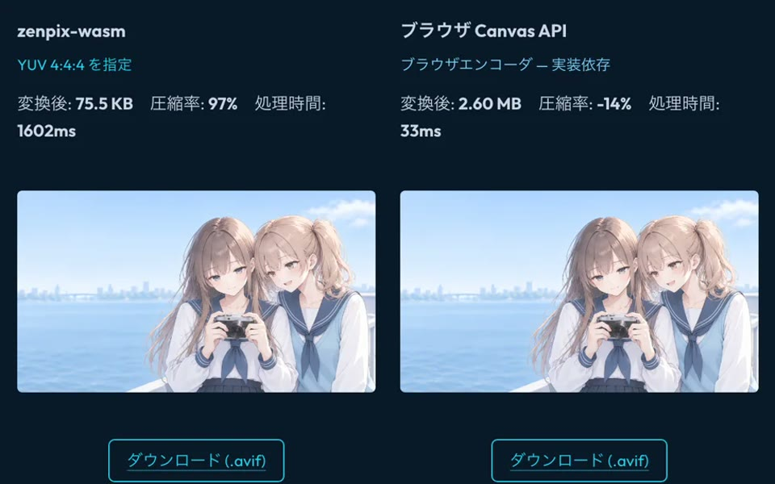
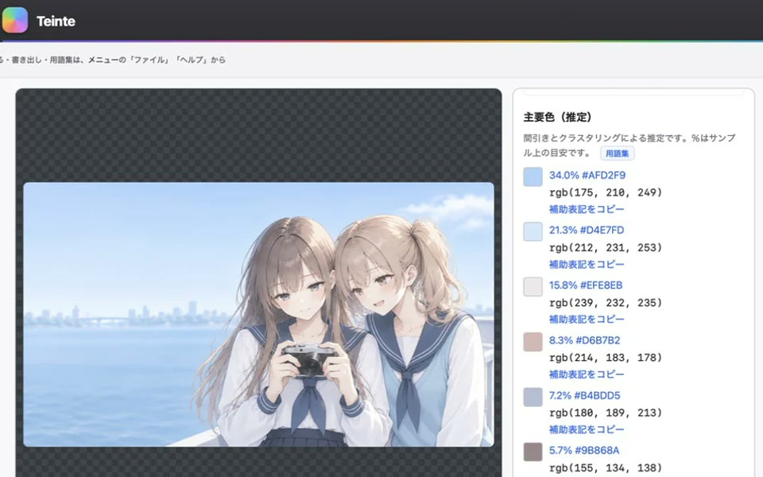

  

  <a href="https://tsukasa-art.com/"><b>ポートフォリオサイト</b></a> ·
  <a href="https://zenn.dev/tsukasa_art"><b>Zenn</b></a> ·
  <a href="https://tsukasa-art.com/contact/"><b>お問い合わせ</b></a> ·
  <a href="./README.en.md">English</a>

> **就職先を探しています。** 内定承諾から1か月ほどで入社できます。業務の困りごとを解くアプリや、自社プロダクトの開発を志望しています。勤務地は札幌を希望（東京も検討）。 
> GitHubとZennでは、ペンネームの「月村つかさ」を使っています。

 

## 現場で使われているもの

<table>
<tr>
<td width="50%" valign="top">

<h3>Salon Register</h3>
<b>美容室で、2025年10月から毎日使われているレジ。</b> 
施術の組み合わせで変わる割引を、会計の中で自動で計算します。スタッフの手計算をなくし、計算ミスと接客の待ち時間を減らしました。  
<a href="https://tsukasa-art.com/projects/salon-register/">事例を見る</a> · <a href="https://salon-register-demo.pages.dev/">公開デモ</a> · <a href="https://github.com/tsukasa-art/salon-register-demo">GitHub</a>
</td>
<td width="50%" valign="top">

<h3>JAN Sync</h3>
<b>棚の前で、スマホだけで JAN を読んで数える。</b> 
同じ商品は読むたびに個数が増え、表計算へそのまま書き出せます。通信がなくても動き、読んだコードは端末の外へ送りません。  
<a href="https://tsukasa-art.com/projects/jan-sync/">事例を見る</a> · <a href="https://jan-sync.pages.dev/">公開デモ</a> · <a href="https://github.com/tsukasa-art/jan-sync">GitHub</a>
</td>
</tr>
</table>

## Orrery — Windows のノベルゲームを、Mac で

<table>
<tr>
<td width="50%" valign="top">

<h3>KASANE（カサネ）</h3>
<b>Apple Silicon の Mac で、Windows のノベルゲームを遊ぶランチャー。</b> 
既存の Wine 構成では動かない作品を、描画・動画・音声・ウィンドウ制御まで一つずつ切り分けて動かしています。クローズドベータの待機リストを受付中です。  
<a href="https://tsukasa-art.com/projects/orrery/kasane/">KASANE</a> · <a href="https://tsukasa-art.com/projects/orrery/">Orrery の全体像</a>
</td>
<td width="50%" valign="top">

<h3>Case Notes — 17本</h3>
<b>動かなかった原因を、症状から層ごとに切り分けた記録。</b> 
「動画だけ白い」「セーブ画像が黒い」などの症状から、Wine・DirectX・Metal のどこで止まっていたかを突き止め、直した道筋を残しています。  
<a href="https://tsukasa-art.com/projects/orrery/notes/why-mac-windows-games-are-hard/">入口の記事</a> · <a href="https://github.com/tsukasa-art/swingby-wine">swingby-wine</a> · <a href="https://github.com/tsukasa-art/swingby-dxvk">swingby-dxvk</a> · <a href="https://github.com/tsukasa-art/melammu-vn">melammu-vn</a>
</td>
</tr>
</table>

## 絵を描くための道具

<table>
<tr>
<td width="50%" valign="top">

<h3>zenpix</h3>
<b>8.9 MB の絵が、91 KB に。</b> 
C 製の画像変換ライブラリ。読み込み・縮小・AVIF / WebP への書き出しを、コマンド・Node.js・Bun・Deno・ブラウザ（WASM）から使えます。このサイトの画像も zenpix で変換しています。  
<a href="https://tsukasa-art.com/projects/zenpix/">事例を見る</a> · <a href="https://zenpix.tsukasa-art.com/">ドキュメント</a> · <a href="https://www.npmjs.com/package/zenpix">npm</a> · <a href="https://github.com/tsukasa-art/zenpix">GitHub</a>
</td>
<td width="50%" valign="top">

<h3>teinte</h3>
<b>絵の色を、数値と名前で並べる。</b> 
画像から主要色を取り出し、Open Color・Tailwind の近い色名と、配色の役割（ベース・アソート・アクセント）を出すデスクトップアプリ。Vue と Rust、Tauri で作っています。  
<a href="https://tsukasa-art.com/projects/teinte/">事例を見る</a> · <a href="https://github.com/tsukasa-art/teinte">GitHub</a>
</td>
</tr>
</table>

## Zenn

調べた現象、立てた仮説、外れた道、最後の判断までを公開しています。
- [連載：Mac で Windows のノベルゲームを動かす](https://zenn.dev/tsukasa_art/articles/mac-eroge-compat-part1)
- [Book：コードから実行まで](https://zenn.dev/tsukasa_art/books/code-to-runtime) · [Book：動画再生のしくみ](https://zenn.dev/tsukasa_art/books/media-playback-pipeline)

## 開発で大事にしていること

- 推測より先に、ログ・再現手順・実機の動きを確かめる
- 技術は、使う人の体験・運用・再現性まで含めて選ぶ
- AI を使っても、公開する範囲・レビュー・検証・最後の判断は自分で持つ
- なぜ変えたか、何が直ったか、どう確かめたかを、後から追える形で残す

**Languages:** TypeScript / JavaScript / C / Rust / Swift 
**Frameworks & UI:** React / React Router v7 / Next.js / Astro / Vue / SolidJS / Svelte / SvelteKit / SwiftUI / Tauri 
**プロダクト・アプリケーション実装:** Ruby on Railsによる再構築プロトタイプ / PWA・オフラインファースト / CMS・リッチテキストエディタ（Tiptap）/ 認証・セッション管理（Oslo / Better Auth）/ PostgreSQL・Cloudflare D1 / Wine / macOS / Cloudflare

## Contact

採用・開発のご相談は、[お問い合わせフォーム](https://tsukasa-art.com/contact/)からお願いします。
